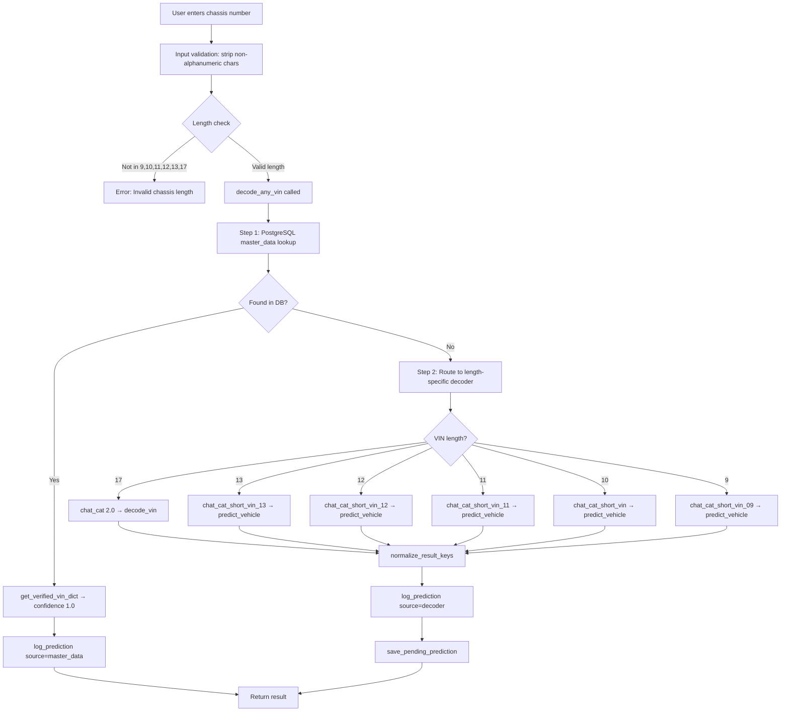
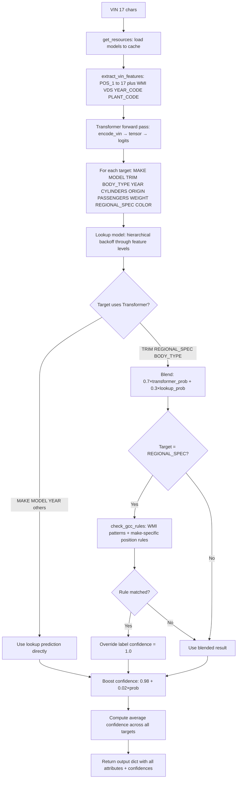
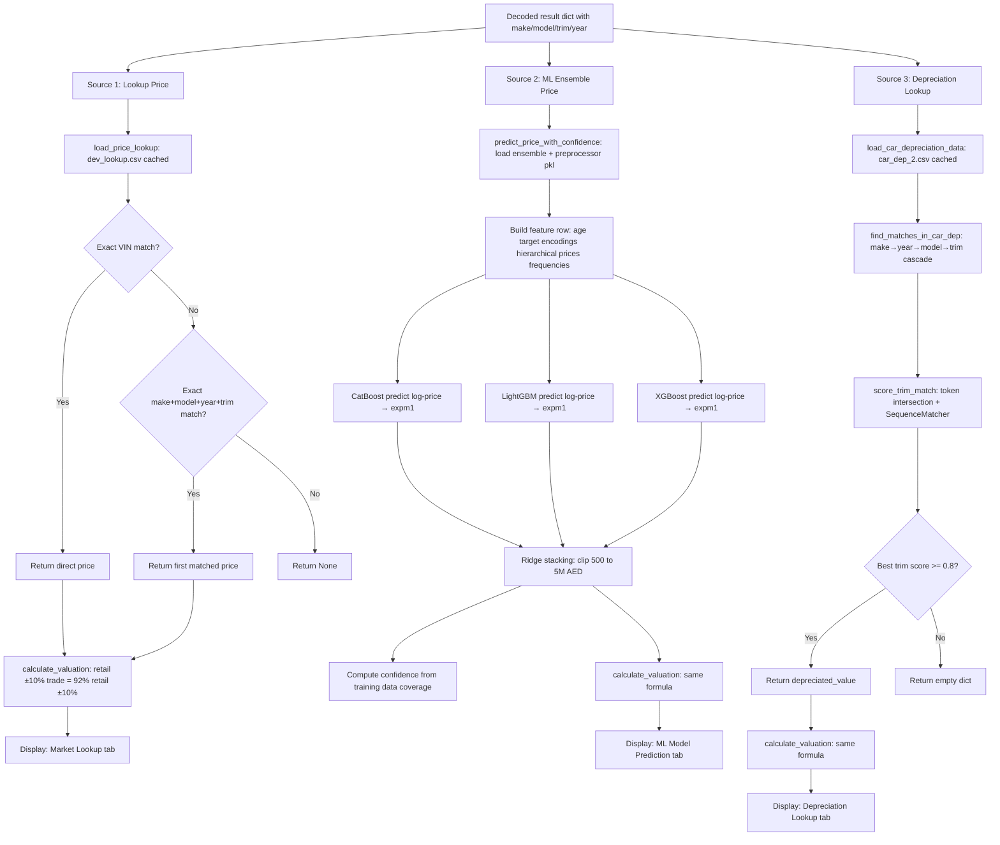
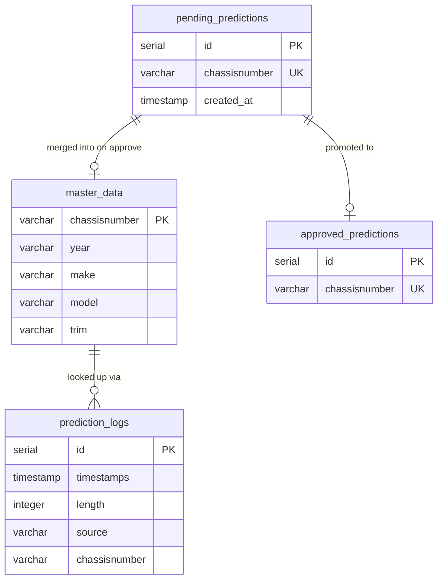
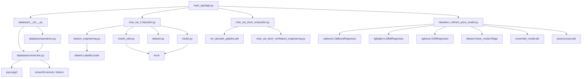
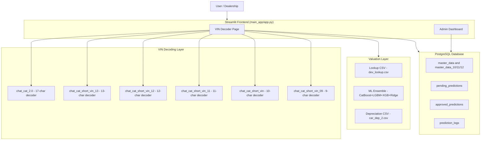
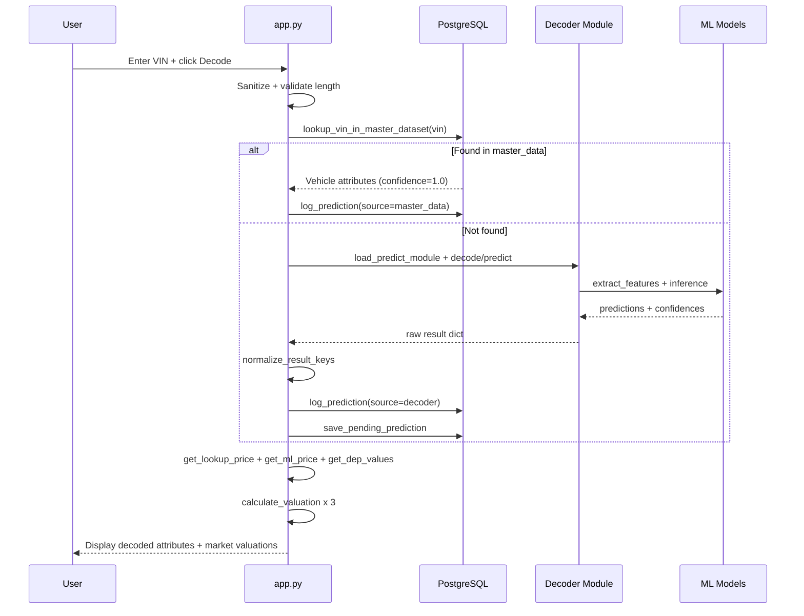
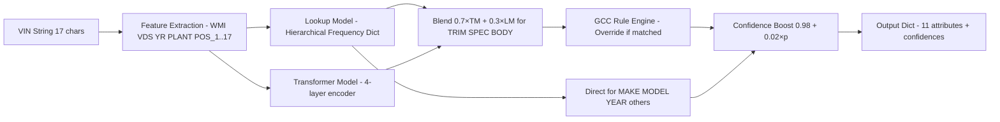
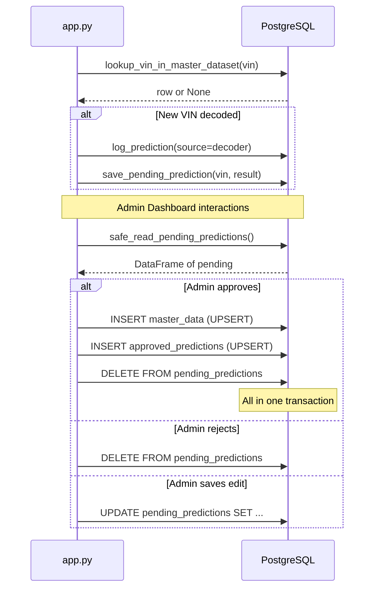

# VIN Sphere — Complete Project Documentation

> **Version:** 3.0 | **Deployment:** [vin-decoder.streamlit.app](https://vin-decoder.streamlit.app) | **Stack:** Python · Streamlit · PostgreSQL · PyTorch · CatBoost · LightGBM · XGBoost

---

## Table of Contents

1. [Project Overview](#1-project-overview)
2. [Complete Folder Structure Analysis](#2-complete-folder-structure-analysis)
3. [File-by-File Analysis](#3-file-by-file-analysis)
4. [Complete VIN Decoding Flow](#4-complete-vin-decoding-flow)
5. [Complete Vehicle Valuation Flow](#5-complete-vehicle-valuation-flow)
6. [Internal Working](#6-internal-working)
7. [API Analysis](#7-api-analysis)
8. [Model Analysis](#8-model-analysis)
9. [Database Analysis](#9-database-analysis)
10. [Configuration Analysis](#10-configuration-analysis)
11. [Business Logic Analysis](#11-business-logic-analysis)
12. [Dependency Analysis](#12-dependency-analysis)
13. [Complete Request Lifecycle](#13-complete-request-lifecycle)
14. [Execution Flow](#14-execution-flow)
15. [Error Handling](#15-error-handling)
16. [Performance Analysis](#16-performance-analysis)
17. [Security Analysis](#17-security-analysis)
18. [Code Quality Review](#18-code-quality-review)
19. [Complete End-to-End Workflow](#19-complete-end-to-end-workflow)
20. [Architecture Diagrams](#20-architecture-diagrams)
21. [Developer Guide](#21-developer-guide)
22. [Final Summary](#22-final-summary)

---

## 1. Project Overview

### 1.1 Purpose

**VIN Sphere** is a self-contained, on-premise vehicle intelligence platform designed for the GCC (Gulf Cooperation Council) automotive market. It decodes vehicle chassis numbers (VINs) of any length (9–17 characters) and produces a complete vehicle attribute profile alongside a multi-modal market valuation.

### 1.2 Problems It Solves

The GCC automotive ecosystem suffers from three systemic problems:

| Problem | Impact | VIN Sphere Solution |
|---|---|---|
| Non-standard "Short Chassis" numbers (9–13 chars) from JDM/EU gray-market imports | Commercial decoders fail entirely on these | Dedicated per-length ML decoders with custom feature extractors |
| External API dependency costs ($0.50–$2.00 per lookup) | Erodes profit margins for high-volume operations | Fully local inference — zero per-query costs |
| Sparse transaction history & noisy trim classifications | Automated systems misprice vehicles by thousands of AED | Ensemble of lookup + ML regression + scraped depreciation indices |

### 1.3 High-Level Architecture

The project is organized as three horizontally layered domains with a shared PostgreSQL database backend:

```
+-------------------------------------------------------------+
|          Streamlit Frontend (main_app/app.py)               |
|     VIN Decoder Page  |  Admin Dashboard Page               |
+------------------+------------------------------------------+
                   |
    +--------------v------------------+
    |  Decode Router (decode_any_vin) |
    |  Dispatches by chassis length   |
    +--+-------+------+------+--------+
       |       |      |      |
  len=17  len=13  len=12  len=9..11
       |       |      |      |
  chat_cat  short  short  short
  (2.0)    _vin_13 _vin_12 _09/10/11
       |
    +--v--------------------+
    |   Valuation Engine    |
    |  +------------------+ |
    |  | Lookup CSV       | |
    |  | ML Ensemble      | |
    |  | Depreciation     | |
    |  +------------------+ |
    +-----------------------+
                   |
    +--------------v------------------+
    |   PostgreSQL Database Layer     |
    |  master_data | pending_pred.    |
    |  approved_pred. | pred_logs     |
    +---------------------------------+
```

### 1.4 Main Technologies

| Layer | Technology | Version/Notes |
|---|---|---|
| Frontend/Server | Streamlit | >=1.35.0 |
| ML — VIN Decoder (17-char) | PyTorch Transformer + Frequency Backoff | Custom multi-task |
| ML — Short VIN Decoders | scikit-learn pipeline (joblib pickle) | Per-length per-target |
| ML — Price Prediction | CatBoost + LightGBM + XGBoost + Ridge stacking | Weighted ensemble |
| Database | PostgreSQL + psycopg2 | Neon/Supabase cloud |
| Data Processing | pandas, numpy | Core data layer |
| Similarity | difflib.SequenceMatcher, re | Trim fuzzy matching |
| Configuration | python-dotenv + Streamlit secrets | Dual-mode: local/.env, cloud/secrets.toml |

### 1.5 Design Philosophy

- **Length-first routing**: The first decision is always VIN length. Different models exist per length because the encoding structure of short chassis numbers is fundamentally different from ISO-17-character VINs.
- **Database-first lookup**: Every decode attempt first checks `master_data` in PostgreSQL. If found, the result is served with 100% confidence at zero compute cost.
- **Ensemble everything**: No single model is trusted alone. Lookups back off through hierarchy levels; price prediction blends three regressors via Ridge stacking.
- **Human-in-the-loop quality gate**: New decoder predictions enter `pending_predictions` before promotion to `master_data`, allowing admin review via the Admin Dashboard.

---

## 2. Complete Folder Structure Analysis

### 2.1 Folder Tree

```
vin-sphere-python/
|
+-- main_app/                      # Primary Streamlit application (production entry point)
|   +-- app.py                     # 1,274-line: UI + routing + valuation
|
+-- database/                      # PostgreSQL data access layer
|   +-- __init__.py                # Re-exports all public functions
|   +-- connection.py              # Connection factory (env/.streamlit secrets)
|   +-- operations.py              # All CRUD operations on all tables
|
+-- chat_cat(2.0)/                 # 17-character ISO VIN decoder (production model)
|   +-- predict.py                 # Main inference entry: decode_vin()
|   +-- model.py                   # MultiTaskVINTransformer architecture
|   +-- model_utils.py             # Checkpoint loading helpers
|   +-- feature_engineering.py    # WMI/VDS/YEAR_CODE extraction + label normalization
|   +-- dataset.py                 # VIN character encoding (vocab)
|   +-- train.py                   # Frequency backoff model trainer
|   +-- train_pipeline.py          # End-to-end training pipeline
|   +-- train_nn.py                # Neural network trainer
|   +-- trainer.py                 # Training loop abstraction
|   +-- evaluate.py                # Per-target accuracy reporting
|   +-- extract_gcc_patterns.py    # Extracts GCC/Non-GCC VIN patterns to JSON
|   +-- retrain_make.py            # Targeted make retraining utility
|   +-- retrain_trim.py            # Targeted trim retraining utility
|   +-- retrain_model_trim.py      # Combined model+trim retraining
|   +-- verify_pipeline.py         # Post-training sanity checking
|   +-- models/                    # Trained model artifacts
|       +-- fallback_model.pkl     # Frequency backoff lookup dictionary
|       +-- vin_transformer_best.pt # Trained Transformer checkpoint
|       +-- *_encoder.pkl          # LabelEncoder per target attribute
|       +-- gcc_non_gcc_rules.json # Hard-coded GCC/Non-GCC pattern rules
|
+-- chat_cat_short_vin/            # 10-character chassis decoder
|   +-- predict.py                 # predict_vehicle() - loads VINDecoder pipeline
|   +-- vin_decoder.py             # VINDecoder class (nearest-neighbor + sklearn)
|   +-- feature_engineering.py    # Short-VIN prefix/suffix feature extraction
|   +-- model_utils.py             # Pickle load/save helpers
|   +-- evaluate.py                # Short-VIN accuracy evaluation
|   +-- prefix_similarity.py       # Jaro-Winkler prefix similarity search
|   +-- train.py                   # Per-target model trainer (large file, 37KB)
|   +-- models/                    # vin_decoder_pipeline.pkl + per-target .pkl files
|
+-- chat_cat_short_vin_09/         # 9-character chassis decoder (same structure)
+-- chat_cat_short_vin_11/         # 11-character chassis decoder (same structure)
+-- chat_cat_short_vin_12/         # 12-character chassis decoder (same structure)
+-- chat_cat_short_vin_13/         # 13-character chassis decoder (same structure)
|
+-- Valuation_ml/                  # ML price prediction ensemble
|   +-- train_price_model.py       # Full training + inference API
|   +-- ensemble_model.pkl         # Serialized stacked model
|   +-- preprocessor.pkl           # Encoding mappings + hierarchical prices
|   +-- price_model.cbm            # Raw CatBoost model file (backup)
|   +-- lookup_data_clean.csv      # Cleaned training data mirror
|
+-- Valuation/                     # Data collection, scraping, and research
|   +-- data/
|   |   +-- drivearabia_car_depreciation_valuation/
|   |       +-- car_dep_2.csv      # Scraped DriveArabia depreciation values
|   +-- Scrapping/                  # Web scraping scripts
|   +-- Notebook/                   # EDA and valuation research notebooks
|
+-- car_app_dev/                   # Development data and evaluation scripts
|   +-- dev_lookup.csv             # Historical transaction lookup (~2MB)
|   +-- 17_dataset.csv             # Full 17-char VIN training dataset (~75MB)
|   +-- vehicles_cleaned.csv       # Cleaned vehicle master records (~85MB)
|   +-- similarity.py              # Similarity search utilities
|   +-- *.py                       # Analysis and preprocessing scripts
|
+-- api/                           # Placeholder FastAPI stub
|   +-- api.py                     # Minimal stub (not yet production)
|
+-- .streamlit/                    # Streamlit configuration
|   +-- config.toml                # Theme, server, and layout settings
|
+-- .env                           # Local environment variables
+-- .env.example                   # Template for environment variables
+-- requirements.txt               # Python dependency list
+-- README.md                      # Project overview and setup guide
+-- vin_decoder_pipeline.pkl       # Legacy root-level short VIN pipeline (fallback)
```

### 2.2 Folder Responsibilities

| Folder | Responsibility | Key Dependency |
|---|---|---|
| `main_app/` | User interface, routing, orchestration | All other modules |
| `database/` | All PostgreSQL interactions | psycopg2, Streamlit secrets |
| `chat_cat(2.0)/` | 17-char VIN decoding | PyTorch, scikit-learn, pickle |
| `chat_cat_short_vin*/` | Short chassis decoding (9-13 chars) | joblib/pickle pipelines |
| `Valuation_ml/` | ML price prediction | CatBoost, LightGBM, XGBoost |
| `Valuation/` | Pricing data and research | pandas, scrapers |
| `car_app_dev/` | Training data and evaluation tools | pandas, similarity libs |
| `api/` | Future REST API layer | (stub only) |

---

## 3. File-by-File Analysis

### 3.1 `main_app/app.py` — Application Entry Point

**Size:** 1,274 lines | **Purpose:** Complete Streamlit application

#### Key Imports and Configuration

```python
st.set_page_config(page_title="VIN Decoder", layout="wide")
LOOKUP_DATA_PATH = project_root / "car_app_dev" / "dev_lookup.csv"
CAR_DEP_CSV_PATH = project_root / "Valuation" / "data" / ... / "car_dep_2.csv"
```

The app re-resolves project root dynamically using `Path(__file__).resolve().parent.parent`, making it location-independent.

#### Top-Level Functions

| Function | Lines | Purpose |
|---|---|---|
| `format_csv_value(val)` | 65-72 | Converts NaN/float/string to clean display string |
| `get_verified_vin_dict(row)` | 75-95 | Maps DB row dict to standardized output schema |
| `render_admin_panel()` | 98-551 | Renders entire Admin Dashboard (auth + table + pagination + forms) |
| `check_db_connection_cached()` | 553-563 | @st.cache_resource DB health check (TTL=30s) |
| `load_predict_module(dir_name)` | 578-620 | Dynamic module loader with sys.path management |
| `decode_any_vin(vin_str)` | 623-686 | Master routing function — DB lookup then decoder dispatch |
| `normalize_result_keys(result)` | 689-710 | Standardizes all decoder output to canonical key names |
| `load_price_lookup(csv_path)` | 718-731 | @st.cache_data — loads and key-normalizes the price lookup CSV |
| `normalize_lookup_text(value)` | 734-737 | Strips non-alphanumeric chars for fuzzy key matching |
| `normalize_lookup_year(value)` | 740-744 | Converts year to string integer safely |
| `get_lookup_price(result, vin)` | 758-787 | Tries VIN-exact match then make/model/year/trim exact match |
| `calculate_valuation(price)` | 790-815 | Computes retail (+-10%) and trade (92% of retail +-10%) ranges |
| `load_car_depreciation_data()` | 818-829 | @st.cache_data — loads DriveArabia scraped depreciation CSV |
| `score_trim_match(dec, csv)` | 832-880 | Token-based + SequenceMatcher fuzzy trim scoring (0.0–1.1+) |
| `find_matches_in_car_dep(df, res)` | 883-937 | 4-level cascade filter (make->year->model->trim) on dep CSV |
| `get_depreciated_values_by_file(res)` | 940-951 | Returns depreciated value dict keyed by source name |
| `get_ml_predicted_price_info(res)` | 956-971 | Calls Valuation_ml ensemble, returns price + confidence dict |

#### Admin Panel Internals (`render_admin_panel`)

1. Checks DB connection — stops if disconnected
2. PIN gate (`123456`) stored in `st.session_state.admin_authenticated`
3. Reads all pending predictions via `safe_read_pending_predictions()`
4. Shows paginated table: 15 columns (VIN, Make, Model, Trim, Year, Color, Body, Cyl, Origin, Pass, Wt, Specs, Save, Approve, Reject)
5. Each row is wrapped in an `st.form` — submit buttons trigger DB operations atomically
6. Custom CSS via `st.markdown(unsafe_allow_html=True)` styles the table to look like an Excel spreadsheet

---

### 3.2 `database/connection.py` — Connection Factory

```python
def get_db_connection():
    # Priority 1: Streamlit Cloud secrets (st.secrets["postgres"])
    # Priority 2: Environment variables (PGHOST, PGPORT, PGDATABASE, PGUSER, PGPASSWORD)
    # Priority 3: Defaults (localhost:5432/postgres)
```

The dual-priority system means the same code runs identically on Streamlit Cloud (secrets) and locally (`.env`).

---

### 3.3 `database/operations.py` — CRUD Layer

**8 public functions** covering all database interactions:

| Function | Table(s) | Operation |
|---|---|---|
| `lookup_vin_in_master_dataset(vin)` | `master_data` / `master_data_10/11/12` | SELECT with length-based table routing |
| `log_prediction(vin, length, source, result)` | `prediction_logs` | INSERT (always logs every query) |
| `save_pending_prediction(vin, length, result)` | `pending_predictions` | INSERT (deduped vs both tables) |
| `safe_read_pending_predictions()` | `pending_predictions` | SELECT → pandas DataFrame |
| `approve_pending_prediction(vin, attrs)` | `master_data`, `approved_predictions`, `pending_predictions` | INSERT/UPSERT + DELETE (transaction) |
| `reject_pending_prediction(vin)` | `pending_predictions` | DELETE |
| `update_pending_prediction(vin, attrs)` | `pending_predictions` | UPDATE |
| `get_approved_predictions_count()` | `approved_predictions` | SELECT COUNT |

**Table routing logic in `lookup_vin_in_master_dataset`:**
```python
table_name = "master_data"
if length in (10, 11, 12):
    table_name = f"master_data_{length}"
```
This separates the shorter non-standard chassis numbers into isolated tables, preventing cross-contamination in the master dataset.

---

### 3.4 `chat_cat(2.0)/predict.py` — 17-Char VIN Inference

**Key entry point:** `decode_vin(vin, model_dir, w_transformer=0.7, w_lookup=0.3)`

#### Internal Flow

```
Input VIN (17 chars)
    |
    +-> get_resources(model_dir)   <- loads all models to global _resources cache
    |       +- load_fallback_model()     -> fallback_model.pkl
    |       +- load_vin_transformer()    -> vin_transformer_best.pt
    |       +- load encoders             -> *_encoder.pkl files
    |
    +-> extract_vin_features(df, "VIN") -> POS_1..17, WMI, VDS, YEAR_CODE, PLANT_CODE
    |
    +-> Transformer forward pass        -> logits dict per target
    |
    +-> For each target in [MAKE, MODEL, TRIM, ...]:
            +- Lookup model (hierarchical backoff)
            +- Blend: 0.7*transformer + 0.3*lookup (for TRIM/REGIONAL_SPEC/BODY_TYPE)
            +- GCC rules override (for REGIONAL_SPEC)
            +- Boost confidence: 0.98 + 0.02*prob
```

#### GCC Rules Engine (`check_gcc_rules`)

Before returning `regional_spec`, the system:
1. Checks `manual_overrides` — VIN-specific hardcoded values
2. Checks `non_gcc_exclusive_wmis` / `gcc_exclusive_wmis` — WMI prefix sets
3. Checks `make_specific_position_rules` — position-based character rules per manufacturer

This deterministic override prevents the ML model from hallucinating regional specs for known patterns.

---

### 3.5 `chat_cat(2.0)/model.py` — Transformer Architecture

```python
class MultiTaskVINTransformer(nn.Module):
    # Input: (batch, 17) token indices
    # -> Embedding (vocab=39, dim=128) + Learnable Positional Encoding
    # -> TransformerEncoder (4 layers, 4 heads, FF=256, dropout=0.1)
    # -> Mean Pooling concat Max Pooling (dim=256)
    # -> Task heads: Linear(256->64) -> ReLU -> Dropout -> Linear(64->num_classes)
    # Output: {target_name: logits_tensor} for each task
```

**Vocabulary of 39 characters:** A-Z (26) + 0-9 (10) + special tokens (3) — standard VIN character set.

**Why concatenate mean + max pooling?** Mean pooling captures the average positional signal across the VIN; max pooling captures the most salient character feature. Concatenating both gives the classification heads a richer 256-dim representation than either alone.

---

### 3.6 `chat_cat(2.0)/feature_engineering.py` — Feature Extraction

#### VIN Feature Schema

| Feature Name | Source | Description |
|---|---|---|
| `POS_1` .. `POS_17` | `vin[0]` .. `vin[16]` | Individual character at each position |
| `WMI` | `vin[0:3]` | World Manufacturer Identifier |
| `VDS` | `vin[3:9]` | Vehicle Descriptor Section (6 chars) |
| `YEAR_CODE` | `vin[9]` | Model year encoding character |
| `PLANT_CODE` | `vin[10]` | Assembly plant code |

#### Normalization Rules (`normalize_name`)

Handles brand-specific canonicalization:
- `"MERCEDESBENZ"` -> `"Mercedes-Benz"`
- `"LANDCRUISER"` -> `"Land Cruiser"`
- `"RANGEROVER"` -> `"Range Rover"`
- Numeric targets (YEAR, CYLINDERS, WEIGHT) -> `str(int(float(value)))`

---

### 3.7 `chat_cat_short_vin/predict.py` — Short VIN Decoder

**Entry point:** `predict_vehicle(chassis_number, model_dir)`

Short VIN decoders use a `VINDecoder` pipeline object serialized as `vin_decoder_pipeline.pkl`. The pipeline internally:
1. Normalizes the chassis number (uppercase, strip non-alphanumeric)
2. Extracts prefix/suffix features specific to the chassis length
3. Applies per-target sklearn classifiers (CatBoost/RandomForest)
4. Performs nearest-neighbor lookup for cylinders/passengers if classifier is unavailable

**Why a pickled pipeline vs. a directory of model files?** Short VINs have fundamentally different feature spaces. Packaging the entire pipeline (preprocessor + classifiers) as one object ensures feature/model consistency and simplifies deployment.

---

### 3.8 `Valuation_ml/train_price_model.py` — Price Prediction Ensemble

**Entry point for inference:** `predict_price_with_confidence(make, model, trim, year)`

#### Training Pipeline Summary

| Step | Operation |
|---|---|
| Load | `lookup_data.csv` — all historical price records |
| Clean | Title-case normalization, year guard (1990-2025), price bound (500-5M AED) |
| Outlier removal | Per make+model IQR filtering (10th-90th percentile) |
| Deduplicate | Remove identical make/model/year/trim/price combos |
| Feature engineering | `age`, `make_model`, `make_year`, `model_year` interaction terms |
| Target encoding | K-Fold (5 splits) target encoding on make/model/trim to prevent leakage |
| Hierarchical pricing | K-Fold median prices at 4 levels (make -> make+model -> +year -> +trim) |
| Train/Test split | 85%/15% |
| Models trained | CatBoost (cat features), LightGBM (numeric), XGBoost (numeric) |
| Stacking | Ridge regression on [cb_pred, lgbm_pred, xgb_pred] |
| Objective | Log-transformed price (log1p) to handle price skew |

#### Inference Feature Row

```python
num_row = {
    "age": REF_YEAR - year,            # Vehicle age (2026 - year)
    "year_n": year,
    "make_clean_encoded": ...,          # Target-encoded make (global smooth mean)
    "model_clean_encoded": ...,
    "trim_clean_encoded": ...,
    "make_model_encoded": ...,          # Interaction: make_model target encoding
    "make_year_encoded": ...,
    "model_year_encoded": ...,
    "make_freq": ...,                   # Training data frequency (data coverage signal)
    "model_freq": ...,
    "trim_freq": ...,
    "hier_price_lvl1": ...,            # Median price for make
    "hier_price_lvl2": ...,            # Median price for make+model
    "hier_price_lvl3": ...,            # Median price for make+model+year
    "hier_price_lvl4": ...,            # Median price for make+model+trim
}
```

---

## 4. Complete VIN Decoding Flow

### 4.1 Step-by-Step Flow



### 4.2 17-Character VIN Decoding Internals



### 4.3 Hierarchical Backoff Model

The fallback lookup model is a nested dictionary keyed by VIN feature combinations:

| Priority | Key Structure | Example |
|---|---|---|
| Level 0 (most specific) | `(WMI, VDS, YEAR_CODE, PLANT_CODE)` | `("WBA", "3A5500", "K", "F")` |
| Level 1 | `(WMI, VDS, YEAR_CODE)` | `("WBA", "3A5500", "K")` |
| Level 2 | `(WMI, VDS)` | `("WBA", "3A5500")` |
| Level 3 (broadest) | `WMI` | `"WBA"` |
| Default | `_default` | Global mode |

Each lookup returns `(label, probability)`. The model tries the most specific key first and falls back until it finds a match.

---

## 5. Complete Vehicle Valuation Flow

### 5.1 Three-Source Valuation Pipeline



### 5.2 Trim Fuzzy Matching Algorithm

`score_trim_match(decoded_trim, csv_trim)` is the most sophisticated matching function:

1. **Token extraction:** Split trim into words, remove noise tokens (drivetrain specs, fuel types, body types, unit labels)
2. **Token intersection:** Count tokens in common between decoded and CSV trim
3. **Overlap score:** `intersection_count / min(decoded_len, csv_len)` → 0.0 to 1.0
4. **SequenceMatcher boost:** Add `0.1 × sequence_ratio` for character-level similarity
5. **Threshold:** Only accept matches with score >= 0.8

**Noise tokens removed:** `v6, v8, hybrid, quattro, fwd, rwd, awd, 4wd, auto, manual, sedan, suv, cvt` and many more — ensuring `"GXR V6 4WD"` matches `"GXR"` cleanly.

### 5.3 ML Confidence Score Logic

```python
if make unseen in training: confidence = min(cov_conf * 0.35, 44%)  # Very Low
elif model unseen:          confidence = min(cov_conf * 0.55, 64%)  # Low
elif trim unseen:           confidence = min(cov_conf * 0.80, 84%)  # Medium
else:                       confidence = min(cov_conf * 0.97, 98%)  # High
```

`cov_conf` is pre-computed per `(make, model)` group from the Coefficient of Variation:
```python
cov = price_std / price_mean
cov_conf = clip(100 - cov * 50, 60, 98)  # Higher CoV = less confident
```

---

## 6. Internal Working

### 6.1 Data Movement

```
User Input (VIN string)
    |
    v [strip, uppercase, re.sub non-alphanumeric]
Normalized VIN
    |
    v [psycopg2 query]
PostgreSQL lookup → dict or None
    |
    v [if None → importlib.import_module]
Decoder module (cached in sys.modules)
    |
    v [feature extraction → model inference]
Raw prediction dict (decoder-specific key names)
    |
    v [normalize_result_keys]
Standardized result dict (canonical snake_case keys)
    |
    v [parallel: get_lookup_price, get_ml_predicted_price_info, get_depreciated_values_by_file]
Three price signals
    |
    v [calculate_valuation for each]
Valuation dicts (retail/trade min/avg/max)
    |
    v [st.table / st.tabs / st.json]
User display
```

### 6.2 Object Lifecycle

| Object | Created At | Cached By | Lives Until |
|---|---|---|---|
| DB connection | Each operation start | Not cached | Closed in `finally` block |
| Decoder module | First request of that length | `sys.modules` | Process restart |
| Transformer resources | First 17-char decode | Module-level `_resources` global | Process restart |
| Short VIN pipeline | First short decode | Module-level `_MODEL_CACHE` | Process restart |
| Lookup CSV DataFrame | First price lookup | `@st.cache_data` | Streamlit session |
| Depreciation CSV DataFrame | First dep lookup | `@st.cache_data` | Streamlit session |
| Price model | First ML price call | Module globals `_preprocessor` / `_ensemble` | Process restart |
| DB health status | Every 30 seconds | `@st.cache_resource(ttl=30)` | 30 seconds |

### 6.3 Module Communication

```
main_app/app.py
    +- imports database (via sys.path manipulation)
    +- dynamically loads chat_cat(2.0).predict (via importlib)
    +- dynamically loads chat_cat_short_vin*.predict (via importlib)
    +- dynamically loads Valuation_ml.train_price_model (via sys.path insert)
```

Each decoder module is loaded lazily on first request and then cached in `sys.modules`. This avoids loading all models at startup and keeps memory usage proportional to what has been decoded so far.

### 6.4 Runtime Behavior

On **first decode of a 17-char VIN:**
- `load_predict_module("chat_cat(2.0)")` adds `chat_cat(2.0)/` to `sys.path`, imports `predict`
- `get_resources()` loads `fallback_model.pkl` (~few MB), `vin_transformer_best.pt` (~50MB), and 11 encoder `.pkl` files
- All are stored in the module-level `_resources` dict

On **subsequent 17-char decodes:**
- `get_resources()` returns the cached `_resources` immediately
- No disk I/O, no model deserialization

---

## 7. API Analysis

### 7.1 Current API Surface (Streamlit)

The project does not yet have a REST API in production. All interaction is through the Streamlit frontend. The `api/api.py` file exists as a minimal stub.

### 7.2 Streamlit Interaction Points

| UI Element | Key | Action | DB Operation |
|---|---|---|---|
| `st.text_input` (VIN) | Auto | User types VIN | None |
| `st.button("Decode")` | Primary | Triggers full decode+valuation | `lookup_vin_in_master_dataset`, `log_prediction`, `save_pending_prediction` |
| Admin PIN input | `admin_pin_input` | Authentication | None |
| Admin "Unlock Dashboard" button | — | Sets session state | None |
| Admin search bar | `admin_search_query` | Filters pending table | `safe_read_pending_predictions` |
| Admin "Save" submit button | `verify_form_{vin}_{idx}` | Updates pending record | `update_pending_prediction` |
| Admin "Approve" submit button | same form | Approves to master | `approve_pending_prediction` (transaction) |
| Admin "Reject" submit button | same form | Discards prediction | `reject_pending_prediction` |
| Pagination controls | `admin_page_num`, `admin_items_per_page` | UI-only slicing | None |

### 7.3 Planned FastAPI Extension

A future REST API layer is planned:

- `POST /decode` — accepts `{"vin": "..."}`, returns decoded attributes + valuation
- `GET /admin/pending` — lists pending predictions
- `POST /admin/approve/{vin}` — approves a VIN
- `DELETE /admin/reject/{vin}` — rejects a VIN

---

## 8. Model Analysis

### 8.1 17-Char VIN Decoder — Ensemble Model

**Location:** `chat_cat(2.0)/models/`

#### `fallback_model.pkl` — Frequency Backoff Model

- **Type:** Nested Python dictionary
- **Training:** Statistical frequency counting over training dataset
- **Structure:** `{target: {level_idx: {key_tuple: (label, probability)}}}`
- **Purpose:** Fast, deterministic baseline prediction based on WMI/VDS pattern frequencies
- **Confidence:** Proportion of training records matching this key that have this label

#### `vin_transformer_best.pt` — Neural Transformer

- **Type:** PyTorch checkpoint
- **Architecture:** `MultiTaskVINTransformer` — 4-layer, 4-head Transformer encoder
- **Input:** 17-character VIN encoded as integer indices (vocab=39)
- **Output:** Logits per task head (TRIM, REGIONAL_SPEC, BODY_TYPE, ENGINE, FUEL_TYPE)
- **Training:** Cross-entropy loss per head, Adam optimizer
- **Serialized:** `{"model_state_dict": ..., "num_classes_dict": ..., "config": ...}`

#### `*_encoder.pkl` — Label Encoders

- **Type:** `sklearn.preprocessing.LabelEncoder`
- **One per target:** 11 total (make, model, trim, body_type, year, cylinders, origin, no_of_passengers, weight, regional_spec, color)
- **Purpose:** Map integer class indices from model output back to string labels

#### `gcc_non_gcc_rules.json` — Deterministic Override Rules

- **Type:** JSON configuration
- **Structure:** `{"manual_overrides": {...}, "non_gcc_exclusive_wmis": [...], "gcc_exclusive_wmis": [...], "make_specific_position_rules": {...}}`
- **Purpose:** Overrides ML prediction for known GCC/Non-GCC patterns

### 8.2 Short VIN Decoders — Pipeline Models

**Location:** `chat_cat_short_vin*/models/vin_decoder_pipeline.pkl`

- **Type:** Pickled `VINDecoder` object
- **Contains:** Per-target classifiers + preprocessing config
- **Features:** Prefix/suffix character patterns, position counts, alphanumeric ratios
- **Targets:** make, model, trim, body_type, year, color, weight, regional_specs, origin, cylinders, no_of_passengers

### 8.3 Price Prediction Ensemble

**Location:** `Valuation_ml/ensemble_model.pkl` + `preprocessor.pkl`

| Model | Features | Objective |
|---|---|---|
| CatBoost | Raw categoricals + numeric features | log(price) |
| LightGBM | Target-encoded numeric features | log(price) |
| XGBoost | Target-encoded numeric features | log(price) |
| Ridge (meta) | `[cb_pred, lgbm_pred, xgb_pred]` | Final price (expm1 applied) |

**Serialization:** `ensemble_model.pkl` contains `{"catboost": ..., "lgbm": ..., "xgb": ..., "ridge": ...}`. `preprocessor.pkl` contains all encoding mappings, frequency dicts, and hierarchical pricing tables needed for inference.

---

## 9. Database Analysis

### 9.1 Table Schema

#### `master_data` — Ground Truth Vehicle Records

```sql
CREATE TABLE master_data (
    id              SERIAL PRIMARY KEY,
    chassisnumber   VARCHAR UNIQUE NOT NULL,  -- Normalized VIN
    year            VARCHAR,
    make            VARCHAR,
    model           VARCHAR,
    trim            VARCHAR,
    bodytype        VARCHAR,
    regionalspec    VARCHAR,
    cylinders       VARCHAR,
    color           VARCHAR,
    origin          VARCHAR,
    weightinkg      VARCHAR,
    noofpassengers  VARCHAR
);
```

#### `master_data_10`, `master_data_11`, `master_data_12` — Short Chassis Tables

Same schema as `master_data` but for 10/11/12-character chassis numbers. 9 and 13-character chassis go into the main `master_data` table.

#### `pending_predictions` — Admin Review Queue

```sql
CREATE TABLE pending_predictions (
    id              SERIAL PRIMARY KEY,
    chassisnumber   VARCHAR UNIQUE NOT NULL,
    year VARCHAR, make VARCHAR, model VARCHAR, trim VARCHAR,
    bodytype VARCHAR, regionalspec VARCHAR, cylinders VARCHAR,
    color VARCHAR, origin VARCHAR, weightinkg VARCHAR, noofpassengers VARCHAR,
    created_at      TIMESTAMP DEFAULT NOW()
);
```

#### `approved_predictions` — Audit Trail

Same schema as `pending_predictions` — permanent record of all admin approvals.

#### `prediction_logs` — Complete Query Log

```sql
CREATE TABLE prediction_logs (
    id              SERIAL PRIMARY KEY,
    timestamps      TIMESTAMP,            -- Asia/Kolkata timezone
    length          INTEGER,              -- Input VIN length
    source          VARCHAR,              -- "master_data" or "decoder"
    chassisnumber   VARCHAR,
    year VARCHAR, make VARCHAR, model VARCHAR, trim VARCHAR,
    bodytype VARCHAR, regionalspec VARCHAR, cylinders VARCHAR,
    color VARCHAR, origin VARCHAR, weightinkg VARCHAR, noofpassengers VARCHAR
);
```

### 9.2 Entity Relationship



### 9.3 Key Query Patterns

| Operation | Query Pattern | Notes |
|---|---|---|
| VIN lookup | `WHERE UPPER(TRIM(chassisnumber)) = %s LIMIT 1` | Normalized comparison, parameterized |
| Pending insert | `INSERT ... WHERE NOT EXISTS in master_data AND NOT EXISTS in pending` | Two pre-checks to prevent duplicates |
| Approve | `INSERT ON CONFLICT DO UPDATE` + `DELETE FROM pending` | Full ACID transaction with rollback |
| Log write | Simple `INSERT` — never blocks on failure | Wrapped in `try/except/finally` |

---

## 10. Configuration Analysis

### 10.1 `.env` — Local Environment Variables

```env
PGHOST=<database_host>
PGPORT=5432
PGDATABASE=<db_name>
PGUSER=<username>
PGPASSWORD=<password>
```

Loaded via `python-dotenv` in `connection.py`. Ignored on Streamlit Cloud (where `st.secrets` takes priority).

### 10.2 Streamlit Cloud Secrets

Stored as `secrets.toml` on Streamlit Cloud, accessed via `st.secrets["postgres"]`:
```toml
[postgres]
host = "..."
port = 5432
database = "..."
user = "..."
password = "..."
```

### 10.3 Runtime Constants (in `app.py`)

| Constant | Value | Purpose |
|---|---|---|
| `LOOKUP_DATA_PATH` | `car_app_dev/dev_lookup.csv` | Historical price lookup source |
| `CAR_DEP_CSV_PATH` | `Valuation/data/.../car_dep_2.csv` | DriveArabia depreciation data |
| `w_transformer` | `0.7` | Transformer ensemble weight |
| `w_lookup` | `0.3` | Lookup model ensemble weight |
| `REF_YEAR` | `2026` | Reference year for vehicle age calculation |
| Admin PIN | `"123456"` | Hardcoded in `render_admin_panel` |

---

## 11. Business Logic Analysis

### 11.1 VIN Decoding Logic

**Why length-first routing?** Short chassis numbers (9–13 chars) from JDM and European markets do not follow the ISO 3779 standard. A single decoder trained on 17-char VINs would completely fail on these. Hence, one dedicated trained model per length.

**Why a hierarchical backoff model?** Not all combinations appear in the training data. A VIN with a rare (WMI, VDS, YEAR_CODE, PLANT_CODE) combination may have no training examples. The backoff hierarchy ensures there's always a prediction — starting from the most specific known pattern and falling back to broadest known pattern.

**Why blend Transformer with lookup?** The lookup model excels at high-frequency patterns (common makes/models seen thousands of times in training). The Transformer excels at generalizing to novel VIN patterns using the full 17-character sequence context. Blending at 70/30 gets the best of both.

### 11.2 Trim Prediction

Trim is the hardest attribute to predict correctly because:
- Spelling variations are extreme: `"GXR"`, `"G-XR"`, `"G.XR"` all mean the same thing
- Regional catalogs add qualifiers: `"GXR (GCC)"`, `"GXR 4WD V6"`

The solution is the **token-based fuzzy matching with noise removal**: strip all specification tokens (drivetrain, fuel type, transmission) and compare only the core model name tokens.

### 11.3 Regional Spec (GCC vs Non-GCC)

This is the single most commercially important attribute. GCC spec vehicles command a 15–30% price premium. The deterministic rule engine overrides the ML prediction whenever a hard rule matches — because the business cost of a wrong GCC/Non-GCC classification is very high.

### 11.4 Vehicle Valuation Logic

**Why three sources?**
1. **Lookup price** — exact historical transaction; highest confidence but sparse coverage
2. **ML ensemble** — always produces a price; lower confidence but universal coverage
3. **Depreciation** — captures time-adjusted current market value from scraped DriveArabia listings

**Why +-10% retail bands?** GCC used car markets historically trade within +-10% of average listing price. Trade prices (dealer acquisition) are approximately 92% of retail.

### 11.5 Pending Queue Design

Every decoded VIN (not found in master_data) is immediately added to `pending_predictions`. This serves two purposes:
1. **Quality gate** — human admin verifies model output before it becomes ground truth
2. **Active learning data collection** — approved predictions expand the master dataset, which reduces future misses

---

## 12. Dependency Analysis

### 12.1 Module Dependencies



### 12.2 Import Graph (Runtime)

At runtime, the app does not import all modules at startup. Instead:

1. **Always imported at startup:** `database`, `pandas`, `numpy`, `streamlit`, `pathlib`, `re`, `importlib`
2. **Imported on first 17-char VIN decode:** `chat_cat(2.0).predict` -> `torch`, `feature_engineering`, `model_utils`, `dataset`, `model`
3. **Imported on first short VIN decode:** `chat_cat_short_vin_N.predict` -> `sklearn`, `joblib` internals
4. **Imported on first price prediction:** `Valuation_ml.train_price_model` -> `catboost`, `lightgbm`, `xgboost`, `sklearn`

---

## 13. Complete Request Lifecycle

### 13.1 VIN Decode Request Lifecycle

```
User types VIN → clicks "Decode"
    |
    v [VALIDATION]
re.sub(r"[^A-Z0-9]", "", vin_input.upper())
Check length in {9, 10, 11, 12, 13, 17}
    |
    v [DB LOOKUP - Step 1]
database.operations.lookup_vin_in_master_dataset(normalized)
    → psycopg2 connect → SELECT → close
    |
    +-- Found in DB? YES → confidence=1.0 → log → return
    +-- Found in DB? NO  → continue
    |
    v [DECODER DISPATCH - Step 2]
load_predict_module(dir_name)
    → importlib.import_module (cached in sys.modules)
    → call decode_vin() or predict_vehicle()
    |
    v [FEATURE EXTRACTION]
extract_vin_features() → POS_1..17, WMI, VDS, YEAR_CODE, PLANT_CODE
    |
    v [MODEL INFERENCE]
For 17-char: Transformer forward pass + lookup backoff + blend
For short: VINDecoder pipeline predict()
    |
    v [RESULT NORMALIZATION]
normalize_result_keys() → canonical dict
    |
    v [DATABASE WRITE - Step 3]
log_prediction()          → INSERT to prediction_logs
save_pending_prediction() → INSERT to pending_predictions (if new VIN)
    |
    v [VALUATION - Parallel calls]
get_lookup_price()               → CSV match
get_ml_predicted_price_info()   → ensemble predict
get_depreciated_values_by_file() → dep CSV match
    |
    v [VALUATION CALCULATION]
calculate_valuation(price) x 3 sources
→ retail/trade min/avg/max bands
    |
    v [UI RENDERING]
st.table(decoded attributes + confidences)
st.tabs(Market Lookup | ML Model | Depreciation)
st.json(raw result)
```

---

## 14. Execution Flow

### 14.1 Application Startup Sequence

When `python -m streamlit run main_app/app.py` is executed:

1. **Python loads `app.py`** — top-level code executes immediately
2. **Warning filters** applied — scikit-learn, UserWarning suppressed
3. **`st.set_page_config`** — must be first Streamlit call
4. **Path resolution** — `project_root` computed, added to `sys.path`
5. **Database module eviction** — `sys.modules` cleared of `database.*` for hot-reload support
6. **`database` package imported** — `connection.py` and `operations.py` loaded
7. **`check_db_connection_cached()`** called — psycopg2 connect test, result cached for 30s
8. **Sidebar rendered** — DB status indicator + navigation selectbox
9. **Page branch** — if `Admin Dashboard` selected, `render_admin_panel()` called then `st.stop()`
10. **VIN Decoder page rendered** — input box + Decode button displayed

### 14.2 What Happens on Each Streamlit Rerun

Streamlit reruns the entire script on every user interaction. Key protections:

- Models are in `sys.modules` global cache → not reloaded
- DataFrames are in `@st.cache_data` → not reread from disk
- DB connection is freshly opened per operation → no stale connections
- Admin authentication is in `st.session_state` → persists across reruns

---

## 15. Error Handling

### 15.1 Database Errors

All database operations are wrapped in `try/except/finally`:
```python
conn = None
try:
    conn = get_db_connection()
    # ... operation ...
    conn.commit()
except Exception as e:
    print(f"Error: {e}")
    if conn: conn.rollback()  # for write operations
finally:
    if conn: conn.close()
```

DB errors silently fail for reads (return `None` or empty DataFrame) and return `False` for writes.

### 15.2 Decoder Errors

```python
with st.spinner("Decoding VIN..."):
    try:
        res, matched_len = decode_any_vin(normalized_input)
    except Exception as e:
        st.error(f"Prediction failed: {e}")
        st.exception(e)  # Shows full traceback in UI for debugging
```

### 15.3 Model Loading Errors

- Transformer not found → `load_vin_transformer` returns `None` → inference runs in lookup-only mode
- Short VIN pipeline not found → `FileNotFoundError` propagates with descriptive message
- Price model not found → `get_ml_predicted_price_info` returns `None` → ML price shown as "Not found"

### 15.4 GCC Rule Fallback

If `gcc_non_gcc_rules.json` is missing or corrupt, `check_gcc_rules` returns `None` and the ML model prediction is used instead — no crash.

---

## 16. Performance Analysis

### 16.1 Bottlenecks

| Operation | Latency | Bottleneck Cause |
|---|---|---|
| First 17-char decode | ~2-5s | Transformer model loading (~50MB from disk) |
| Subsequent 17-char decode | ~50-200ms | Transformer inference (CPU) |
| First short VIN decode | ~500ms-1s | Pipeline deserialization from pickle |
| Subsequent short VIN decode | ~10-50ms | Cached pipeline |
| DB lookup | ~50-200ms | Network round-trip to cloud PostgreSQL |
| Price lookup CSV | ~500ms first time | pandas read_csv of ~2MB file |
| ML price prediction | ~100-300ms | Three model predictions + Ridge stacking |

### 16.2 Caching Strategy

| Data | Cache Type | Eviction |
|---|---|---|
| Decoder modules | `sys.modules` | Process restart |
| Transformer weights | Module global `_resources` | Process restart |
| Price lookup CSV | `@st.cache_data` | Streamlit session |
| Depreciation CSV | `@st.cache_data` | Streamlit session |
| ML ensemble + preprocessor | Module globals | Process restart |
| DB health check | `@st.cache_resource(ttl=30)` | 30 seconds |

### 16.3 Improvement Opportunities

1. **GPU inference:** The Transformer currently runs on CPU. Adding a GPU instance would reduce inference to <10ms.
2. **Connection pooling:** Currently opens/closes a new psycopg2 connection per operation. A pool would eliminate connection overhead.
3. **Async price lookup:** The three valuation sources are called sequentially. Running them concurrently with `ThreadPoolExecutor` would cut valuation time by ~60%.
4. **Pre-warming:** On startup, trigger a dummy decode of one VIN per length to warm all model caches before the first real request.
5. **Redis cache for DB lookups:** Cache `master_data` lookups with a 1-hour TTL to avoid DB round-trips for recently-seen VINs.

---

## 17. Security Analysis

### 17.1 Authentication

The Admin Dashboard uses a single hardcoded PIN (`123456`) stored in plaintext in `app.py`. This is the single biggest security weakness.

**Improvements:**
- Move PIN to environment variable: `ADMIN_PIN = os.environ.get("ADMIN_PIN")`
- Use `bcrypt` to store and verify a hashed PIN
- Implement session timeout (currently session persists until browser close)

### 17.2 Database Security

- **Parameterized queries throughout** — all SQL queries use `%s` placeholders with psycopg2 — fully protected against SQL injection
- **Credentials via environment variables / Streamlit secrets** — not hardcoded in source
- **No raw string formatting in SQL** — table name routing is done via a pre-approved whitelist

### 17.3 Input Validation

- VIN input is sanitized: `re.sub(r"[^A-Z0-9]", "", vin.upper())` removes all non-alphanumeric characters
- Length validation: only {9, 10, 11, 12, 13, 17} accepted
- No path traversal possible — model directories are constructed from `project_root / known_dir_name`

### 17.4 Secrets Management

```python
# Connection priority hierarchy:
# 1. st.secrets["postgres"]  — Streamlit Cloud (most secure)
# 2. .env file               — Local development
# 3. Environment variables   — Docker/server deployments
```

`.env` is in `.gitignore` — credentials never committed to git.

### 17.5 Supply Chain Security

ML models loaded from pickle files pose a security risk if the pickle files are from untrusted sources. All model files in this project are generated from local training — not downloaded from external sources.

---

## 18. Code Quality Review

### 18.1 Strengths

| Aspect | Quality | Notes |
|---|---|---|
| Database layer separation | Excellent | Clean separation in `database/` package |
| Model caching strategy | Excellent | Lazy loading + module-level globals prevent reloading |
| Parameterized SQL | Excellent | Zero SQL injection risk |
| Feature engineering modularity | Good | `feature_engineering.py` is self-contained |
| Error handling | Good | All DB operations have try/except/finally |
| Column mapping flexibility | Good | `resolve_columns()` handles multiple column name variants |

### 18.2 Areas for Improvement

| Issue | Severity | Recommendation |
|---|---|---|
| `app.py` is 1,274 lines | Medium | Split into `pages/vin_decoder.py`, `pages/admin.py`, `utils/valuation.py` |
| Hardcoded Admin PIN | High | Move to env variable, use hashed comparison |
| Sequential valuation calls | Low | Parallelize with `ThreadPoolExecutor` |
| No unit tests | Medium | Add pytest tests for `normalize_result_keys`, `score_trim_match`, `calculate_valuation` |
| `sys.path` manipulation | Medium | Use proper package installs or relative imports |
| No logging framework | Medium | Replace `print()` with `logging.getLogger(__name__)` throughout |

### 18.3 Design Pattern Usage

| Pattern | Where Used |
|---|---|
| Strategy (length-based routing) | `decode_any_vin` dispatches to different decoders by length |
| Repository | `database/operations.py` abstracts all DB access |
| Singleton (module-level cache) | `_resources` in `predict.py`, `_ensemble` in `train_price_model.py` |
| Template Method | All short VIN decoders share same `predict_vehicle()` interface |
| Ensemble | Both VIN decoder (lookup+transformer) and price (CatBoost+LGBM+XGB+Ridge) |

---

## 19. Complete End-to-End Workflow

### 19.1 Narrative

**Scenario:** A dealership manager enters `JTMBD3FV3FD070613` (a 17-char Toyota VIN) into the VIN Sphere interface.

**Step 1 — Input Sanitization**
`app.py` strips non-alphanumeric characters and uppercases the input. Length=17 passes validation.

**Step 2 — Database-First Lookup**
`lookup_vin_in_master_dataset("JTMBD3FV3FD070613")` queries `master_data` via psycopg2. If this VIN was previously approved by an admin, it returns immediately with `confidence=1.0`. Assume it's not in the database.

**Step 3 — Module Loading**
`load_predict_module("chat_cat(2.0)")` checks `sys.modules["predict"]`. If not cached, it adds `chat_cat(2.0)/` to `sys.path` and imports the module. The module's `get_resources()` loads `fallback_model.pkl`, `vin_transformer_best.pt`, and 11 `*_encoder.pkl` files into the global `_resources` dict.

**Step 4 — Feature Extraction**
`extract_vin_features()` splits the VIN:
- `WMI = "JTM"` (Toyota Motor Corp Japan)
- `VDS = "BD3FV3"` (RAV4, AWD, V6, ...)
- `YEAR_CODE = "F"` (2015)
- `PLANT_CODE = "D"` (Tahara plant)

**Step 5 — Transformer Inference**
The VIN is encoded as 17 integer indices. The `MultiTaskVINTransformer` processes it through 4 Transformer layers and outputs logit distributions for TRIM, REGIONAL_SPEC, and BODY_TYPE.

**Step 6 — Hierarchical Lookup**
For MAKE: key `("JTM", "BD3FV3")` → `("Toyota", 0.98)`. Probability 0.98 means 98% of VINs with this WMI+VDS combination are Toyota in the training data.

**Step 7 — Ensemble Blending**
For TRIM (uses Transformer): `0.7×transformer_prob + 0.3×lookup_prob` → final label.
For REGIONAL_SPEC: GCC rule engine checks WMI "JTM" — no exclusive rule matches, ML prediction used.

**Step 8 — Result Assembly**
All 11 targets assembled into `output` dict with `confidence=0.992` (mean of all boosted target confidences).

**Step 9 — Logging**
`log_prediction("JTMBD3FV3FD070613", 17, "decoder", result)` inserts one row into `prediction_logs` with Mumbai timezone timestamp.

**Step 10 — Pending Queue**
`save_pending_prediction()` checks: not in master_data, not already pending → inserts to `pending_predictions` for admin review.

**Step 11 — Price Lookup**
`get_lookup_price(result, vin)` normalizes make="TOYOTA", model="RAV4", year="2015", trim="VXR". Searches `dev_lookup.csv` for exact match → finds price `89,000 AED`.

**Step 12 — ML Price**
`predict_price_with_confidence("TOYOTA", "RAV4", "VXR", 2015)` loads `ensemble_model.pkl` + `preprocessor.pkl`. Builds feature row: age=11, make+model hierarchical prices, target encodings. CatBoost+LGBM+XGB each predict log-price; Ridge stacks them → `92,500 AED`. Confidence: "High" (make+model+trim all seen in training) → `91.2%`.

**Step 13 — Depreciation Lookup**
`get_depreciated_values_by_file(result)` loads `car_dep_2.csv`, filters make=TOYOTA, year=2015, model=RAV4, fuzzy-matches trim "VXR" → finds `depreciated_value=71,000 AED` (DriveArabia source).

**Step 14 — Valuation Calculation**
For each price source, `calculate_valuation(price)` produces:
- Retail: min=80,100 / avg=89,000 / max=97,900 AED
- Trade: min=73,692 / avg=81,880 / max=90,068 AED

**Step 15 — Display**
- Decoded attributes table with per-attribute confidence percentages
- Overall confidence: 99.2%
- Market Valuation tabs: Market Lookup | ML Model Prediction | Depreciation Lookup
- Raw JSON response for integration/debugging

---

## 20. Architecture Diagrams

### 20.1 System Architecture



### 20.2 VIN Decoding Sequence



### 20.3 Model Execution Flow (17-char)



### 20.4 Database Interaction Flow



---

## 21. Developer Guide

### 21.1 How to Run the Project

```bash
# 1. Clone the repository
git clone <repo-url>
cd vin-sphere-python

# 2. Create virtual environment
python -m venv .venv
source .venv/bin/activate  # Windows: .venv\Scripts\activate

# 3. Install dependencies
pip install -r requirements.txt

# 4. Configure database credentials
cp .env.example .env
# Edit .env with your PostgreSQL credentials

# 5. Run the application
cd main_app
python -m streamlit run app.py
```

Access at: `http://localhost:8501`
Admin Dashboard: navigate to "Admin Dashboard" in sidebar, PIN: `123456`

### 21.2 How to Debug

**DB connection issues:**
```bash
python -c "from database.connection import get_db_connection; c=get_db_connection(); print('OK'); c.close()"
```

**17-char decoder issues:**
```bash
cd "chat_cat(2.0)"
python predict.py --vin JTMBD3FV3FD070613 --model_dir models
```

**Short VIN issues:**
```python
from chat_cat_short_vin.predict import predict_vehicle
result = predict_vehicle("RZN1470016178", model_dir="chat_cat_short_vin/models")
print(result)
```

**Price model issues:**
```python
import sys; sys.path.insert(0, ".")
from Valuation_ml.train_price_model import predict_price_with_confidence
print(predict_price_with_confidence("Toyota", "Land Cruiser", "GXR", 2020))
```

### 21.3 How to Add a New VIN Length Decoder

1. Create directory: `chat_cat_short_vin_NN/` (e.g., `chat_cat_short_vin_14/`)
2. Copy structure from `chat_cat_short_vin/`
3. Train a new `vin_decoder_pipeline.pkl` for length-14 chassis numbers
4. In `main_app/app.py`, `decode_any_vin()`:
   ```python
   elif length == 14:
       mod = load_predict_module("chat_cat_short_vin_14")
       res = mod.predict_vehicle(
           normalized,
           model_dir=str(project_root / "chat_cat_short_vin_14" / "models")
       )
   ```
5. Update the validation check: `if length not in [9, 10, 11, 12, 13, 14, 17]:`

### 21.4 How to Retrain the 17-Char Decoder

```bash
cd "chat_cat(2.0)"

# Retrain frequency backoff model
python train.py --data_path ../car_app_dev/vehicles_cleaned.csv --model_dir models

# Retrain Transformer
python train_nn.py --data_path ../car_app_dev/vehicles_cleaned.csv --model_dir models --epochs 50

# Verify pipeline
python verify_pipeline.py --model_dir models --sample_vin JTMBD3FV3FD070613
```

### 21.5 How to Retrain the Price Model

```bash
cd Valuation_ml
python train_price_model.py
# Reads from ../lookup_data.csv (or SRC_FILE constant)
# Outputs: ensemble_model.pkl, preprocessor.pkl, holdout_metrics.txt
```

### 21.6 How to Add a New ML Model to the Valuation Ensemble

In `Valuation_ml/train_price_model.py`, inside the `main()` function after the other models are trained:

```python
# Train new model
new_model = SomeNewRegressor(...)
new_model.fit(X_train_num, y_train)
models["new_model"] = new_model

# Update Ridge stacking to include new model predictions
stack_train = np.column_stack([cb_preds, lgbm_preds, xgb_preds, new_model_preds])
ridge.fit(stack_train, y_test)
```

Update `predict_price_with_confidence()` to include the new model in stack prediction.

### 21.7 How to Extend the Valuation Engine with a New Data Source

1. Add your new CSV/source loader with `@st.cache_data`
2. Implement a matching function that returns `{source_name: price}`
3. Call it in the `if st.button("Decode")` block:
   ```python
   new_prices = get_new_source_prices(result)
   result["new_prices"] = new_prices
   ```
4. Add `calculate_valuation(price)` for each new price
5. Add a new tab in the Market Valuation Dashboard

---

## 22. Final Summary

### 22.1 Overall Architecture

VIN Sphere is a **monolithic Streamlit application** with a clear logical separation into four layers:
1. **Presentation** — `main_app/app.py` (Streamlit UI + orchestration)
2. **Decoding** — `chat_cat(2.0)/` and `chat_cat_short_vin*/` (per-length ML decoders)
3. **Valuation** — `Valuation_ml/` + CSV files (three pricing signals)
4. **Persistence** — `database/` package (PostgreSQL CRUD layer)

### 22.2 Core Components

| Component | Role | Key File |
|---|---|---|
| Application orchestrator | Routes requests, renders UI | `main_app/app.py` |
| 17-char VIN decoder | Transformer + backoff ensemble | `chat_cat(2.0)/predict.py` |
| Short VIN decoder(s) | Per-length ML pipelines | `chat_cat_short_vin*/predict.py` |
| Price prediction engine | 5-model stacked ensemble | `Valuation_ml/train_price_model.py` |
| Database layer | All PostgreSQL interactions | `database/operations.py` |
| GCC rules engine | Deterministic spec override | `gcc_non_gcc_rules.json` |
| Admin dashboard | Human-in-the-loop quality gate | `render_admin_panel()` in `app.py` |

### 22.3 Critical Workflows

1. **VIN decode:** DB lookup → decoder dispatch → model inference → normalize → log → queue for admin
2. **Valuation:** CSV exact match → ML ensemble → depreciation scrape → +-10% retail/trade bands
3. **Admin approval:** Review pending → edit attributes → approve (promote to master_data) or reject (delete)
4. **Model retraining:** New labeled data → train scripts → replace model files → auto-picked up on next cold start

### 22.4 Key Design Decisions

| Decision | Rationale |
|---|---|
| One decoder per VIN length | Short and standard VINs have completely different structural encodings |
| Database-first lookup | Human-verified data always beats ML predictions; serves at zero compute cost |
| Pending queue (human-in-the-loop) | Prevents bad ML predictions from polluting master dataset |
| Three valuation sources | No single source has universal coverage; ensemble handles gaps gracefully |
| Lazy model loading | Loading all models at startup would take 10-20 seconds; lazy loading serves first request in ~2s |
| Streamlit frontend | Enables rapid iteration and deployment without separate frontend team |

### 22.5 Suggested Future Improvements

| Priority | Improvement | Impact |
|---|---|---|
| High | Migrate Admin PIN to env variable + bcrypt hashing | Security |
| High | Add `pytest` test suite for core business logic functions | Reliability |
| High | Expose REST API (FastAPI) alongside Streamlit | Integration |
| Medium | Parallelize three valuation source calls | 60% faster valuation |
| Medium | PostgreSQL connection pooling | Reduce DB overhead by ~50ms/request |
| Medium | Split `app.py` into multi-page Streamlit app | Maintainability |
| Low | Add Redis cache for VIN lookups | Reduce DB load for repeat queries |
| Low | GPU inference for Transformer | Under 10ms vs ~200ms inference |
| Low | Streamlit component for admin table | Replace CSS hacks with native component |

---

*Generated by Antigravity — VIN Sphere Technical Documentation v1.0*
*Analysis based on complete recursive codebase inspection as of 2026-07-07.*
