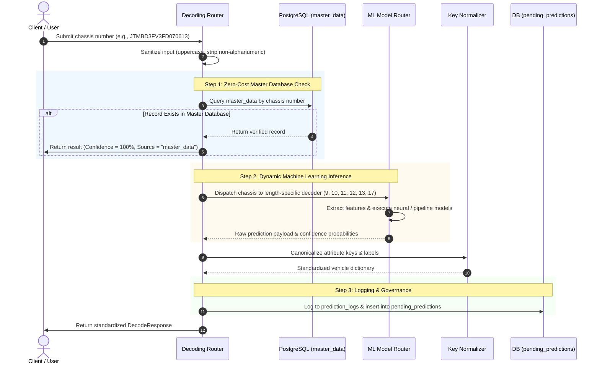
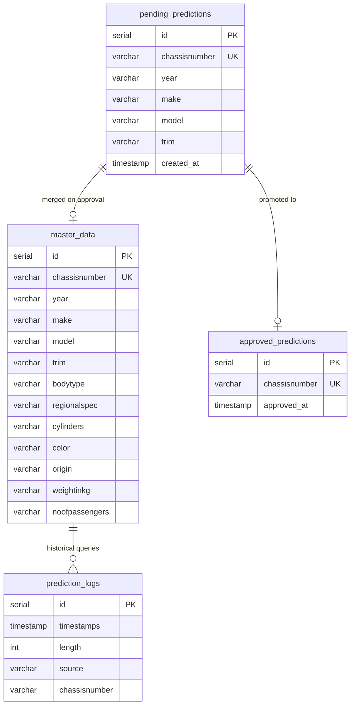

# VIN Sphere — Automotive Chassis Intelligence & Valuation Platform

[](https://www.python.org/)
[](https://fastapi.tiangolo.com/)
[](https://streamlit.io/)
[](https://pytorch.org/)
[](https://www.postgresql.org/)
[]()

**VIN Sphere** is a self-contained, enterprise-grade vehicle intelligence and valuation platform engineered specifically for the **Gulf Cooperation Council (GCC)** and international automotive markets. It decodes vehicle chassis numbers across any length (standard 17-character ISO VINs as well as 9–13 character short chassis numbers) and synthesizes multi-source market valuations using machine learning ensembles, actuarial depreciation curves, and historical auction records.

---

## Table of Contents

- [1. Executive Summary & Problem Solved](#1-executive-summary--problem-solved)
- [2. System Architecture](#2-system-architecture)
- [3. Key Features](#3-key-features)
- [4. Repository Structure](#4-repository-structure)
- [5. Core Workflows](#5-core-workflows)
  - [5.1 VIN Decoding Pipeline](#51-vin-decoding-pipeline)
  - [5.2 Vehicle Valuation Pipeline](#52-vehicle-valuation-pipeline)
  - [5.3 Human-in-the-Loop Admin Quality Gate](#53-human-in-the-loop-admin-quality-gate)
- [6. Machine Learning Subsystems](#6-machine-learning-subsystems)
  - [6.1 17-Character ISO VIN Decoder (`chat_cat(2.0)`)](#61-17-character-iso-vin-decoder-chat_cat20)
  - [6.2 Short Chassis Decoders (9–13 Characters)](#62-short-chassis-decoders-913-characters)
  - [6.3 ML Price Prediction Stacking Ensemble (`Valuation_ml`)](#63-ml-price-prediction-stacking-ensemble-valuation_ml)
  - [6.4 Toyota Valuation Engine (`valuation_engine`)](#64-toyota-valuation-engine-valuation_engine)
- [7. REST API Reference (FastAPI)](#7-rest-api-reference-fastapi)
  - [7.1 Endpoints](#71-endpoints)
  - [7.2 Data Schemas](#72-data-schemas)
  - [7.3 Example Requests & Responses](#73-example-requests--responses)
- [8. Web Application & Admin Dashboard (Streamlit)](#8-web-application--admin-dashboard-streamlit)
- [9. Database Architecture & Schema](#9-database-architecture--schema)
- [10. Installation & Quickstart](#10-installation--quickstart)
  - [10.1 Prerequisites](#101-prerequisites)
  - [10.2 Environment Configuration](#102-environment-configuration)
  - [10.3 Running the FastAPI Backend](#103-running-the-fastapi-backend)
  - [10.4 Running the Streamlit Frontend](#104-running-the-streamlit-frontend)
- [11. Model Retraining & Benchmarking](#11-model-retraining--benchmarking)
- [12. Design Principles & Production Notes](#12-design-principles--production-notes)

---

## 1. Executive Summary & Problem Solved

Automotive operations, insurance appraisers, and dealerships in the Middle East face three unique technical challenges:

| Problem | Traditional Limitation | VIN Sphere Solution |
|---|---|---|
| **Short Chassis Numbers (9–13 chars)** | Non-standard Japanese (JDM) and European gray-market import chassis fail completely on commercial global VIN decoders. | Dedicated per-length ML decoders (9, 10, 11, 12, 13 chars) with character prefix/suffix ngram extraction. |
| **High Per-Query API Costs** | Commercial cloud decoders cost \$0.50 to \$2.00 per lookup, which rapidly drains operating margins in high-volume operations. | Fully local inference powered by PyTorch and scikit-learn models — **zero per-query API costs**. |
| **Volatile GCC Pricing & Sparse Trims** | Generic depreciation models fail to capture GCC-spec retention premiums and regional market dynamics. | 4-tier valuation combining historical transactions, stacked ML regressors, scraped indices, and deterministic actuarial matrices. |

---

## 2. System Architecture

VIN Sphere provides a decoupled, modular architecture serving dual presentation interfaces (FastAPI REST API for automated integrations and Streamlit for human-driven operations):

```mermaid
graph TD
    ClientApp[External Client / Mobile App] -->|HTTP / JSON| FastAPI[FastAPI Server : api/main.py]
    EndUser[Appraiser / Analyst] -->|Browser UI| Streamlit[Streamlit UI : main_app/app.py]

    FastAPI --> DecodeRouter[api/routers/decode.py]
    Streamlit --> MasterRouter[decode_any_vin Dispatcher]

    subgraph Persistence Layer [PostgreSQL Backend]
        MasterDB[(master_data & master_data_10/11/12)]
        PendingQueue[(pending_predictions)]
        ApprovedAudit[(approved_predictions)]
        QueryLogs[(prediction_logs)]
    end

    DecodeRouter --> MasterDB
    MasterRouter --> MasterDB

    DecodeRouter --> ModelRouter[api/services/model_router.py]
    MasterRouter --> ModelLoader[Dynamic Module Loader]

    subgraph Decoding Engines [Length-Specific Decoders]
        ModelRouter -->|len=17| ChatCat17[chat_cat 2.0 : Transformer + Backoff]
        ModelRouter -->|len=13| Short13[chat_cat_short_vin_13]
        ModelRouter -->|len=12| Short12[chat_cat_short_vin_12]
        ModelRouter -->|len=11| Short11[chat_cat_short_vin_11]
        ModelRouter -->|len=10| Short10[chat_cat_short_vin]
        ModelRouter -->|len=9| Short09[chat_cat_short_vin_09]
    end

    subgraph Valuation Subsystem [4-Tier Valuation Services]
        ValuationService[api/services/valuation_service.py]
        LookupPrice[1. Market Lookup CSV dev_lookup.csv]
        MLEnsemble[2. ML Stacking CatBoost + LightGBM + XGBoost]
        DepreciationCSV[3. Scraped DriveArabia Depreciation]
        ToyotaEngine[4. Toyota Actuarial Valuation Engine]
        
        ValuationService --> LookupPrice
        ValuationService --> MLEnsemble
        ValuationService --> DepreciationCSV
        ValuationService --> ToyotaEngine
    end

    DecodeRouter --> ValuationService
    Streamlit --> ValuationService

    DecodeRouter --> PendingQueue
    DecodeRouter --> QueryLogs
    Streamlit --> PendingQueue
    Streamlit --> QueryLogs
```



---

## 3. Key Features

- **Multi-Format VIN Decoding (9 to 17 Characters)**:
  - **Standard 17-Character ISO-3779 VINs**: Deep Transformer network with multi-head attention, character embeddings, frequency backoff fallback, and deterministic GCC regex rule overrides.
  - **Short Chassis Numbers (9, 10, 11, 12, 13 characters)**: Length-specific scikit-learn pipelines analyzing prefix structure, serial digits, and nearest-neighbor attribute matching.
- **11 Decoded Vehicle Attributes**: Make, Model, Year, Trim, Body Type, Cylinders, Origin, Number of Passengers, Weight (kg), Regional Specification (GCC vs. Non-GCC), and Color.
- **Granular Confidence Scores**: Aggregate prediction confidence plus per-attribute probability scores for full interpretability.
- **4-Tier Vehicle Valuation**:
  1. *Historical Market Match*: Exact VIN or Make/Model/Year/Trim lookup in transaction records.
  2. *ML Stacking Ensemble*: CatBoost, LightGBM, and XGBoost blended by Ridge regression with out-of-fold target encoding and hierarchical median pricing.
  3. *DriveArabia Depreciation Index*: Scraped GCC depreciation curves mapped via fuzzy trim matching (`SequenceMatcher` + token intersection).
  4. *Toyota Actuarial Engine*: Formula-based insurance valuation matrix computing base price depreciation adjusted by age, body type, trim, market demand, and regional specs.
- **Retail & Trade Price Bands**: Automated calculation of Retail ($\pm 10\%$) and Wholesale/Trade ($92\% \text{ of retail} \pm 10\%$) value spreads.
- **FastAPI Production REST Service**: Preloaded models via lifespan events, Pydantic v2 validation, ISO-3779 check-digit validation, CORS middleware, and automatic Swagger docs.
- **Human-in-the-Loop Admin Dashboard**: PIN-gated interface allowing appraisers to review newly inferred VINs, edit attributes inline, and promote verified records to the master dataset with audit logging.
- **Automated Retraining Orchestrator**: `retrain.py` script that extracts newly approved ground truth from PostgreSQL and version-trains models into `models/training_xxx/`.

---

## 4. Repository Structure

```
vin-sphere-python/
│
├── api/                               # FastAPI REST backend application
│   ├── config.py                      # API environment settings & directory paths
│   ├── dependencies.py                # Database connection dependency injection
│   ├── main.py                        # FastAPI entry point, lifespan loader & CORS
│   ├── schemas.py                     # Pydantic request/response models
│   ├── routers/
│   │   └── decode.py                  # Endpoints: /api/v1/decode/standard & /short
│   └── services/
│       ├── model_router.py            # Preloaded inference router for lengths 9–17
│       └── valuation_service.py       # Aggregator for all 4 valuation engines
│
├── main_app/                          # Primary Streamlit production application
│   └── app.py                         # 1,960-line interactive dashboard & admin panel
│
├── database/                          # PostgreSQL data access layer
│   ├── __init__.py                    # Public API exports
│   ├── connection.py                  # Dual-source connection factory (.env / secrets)
│   └── operations.py                  # ACID CRUD operations, master lookup, audit logs
│
├── chat_cat(2.0)/                     # 17-character ISO VIN decoder engine
│   ├── model.py                       # MultiTaskVINTransformer PyTorch architecture
│   ├── dataset.py                     # 39-character vocabulary encoder & tensor loader
│   ├── feature_engineering.py         # WMI, VDS, Year Code, Plant Code extractors
│   ├── predict.py                     # Main inference entry point (decode_vin)
│   ├── train.py                       # Frequency backoff model trainer
│   ├── train_nn.py                    # Multi-task neural network trainer
│   └── models/
│       ├── vin_transformer_best.pt    # PyTorch transformer weights
│       ├── fallback_model.pkl         # Hierarchical backoff frequency dictionary
│       ├── *_encoder.pkl              # LabelEncoders for all 11 attributes
│       └── gcc_non_gcc_rules.json     # Deterministic regex & WMI override rules
│
├── chat_cat_short_vin/                # 10-character chassis decoder pipeline
├── chat_cat_short_vin_09/             # 9-character chassis decoder pipeline
├── chat_cat_short_vin_11/             # 11-character chassis decoder pipeline
├── chat_cat_short_vin_12/             # 12-character chassis decoder pipeline
├── chat_cat_short_vin_13/             # 13-character chassis decoder pipeline
│   ├── predict.py                     # predict_vehicle() wrapper
│   ├── vin_decoder.py                 # Pipeline estimator class
│   └── models/
│       └── vin_decoder_pipeline.pkl   # Serialized pipeline model
│
├── valuation_engine/                  # Deterministic Toyota insurance valuation engine
│   ├── __init__.py                    # Public entry exports (ToyotaValuationEngine)
│   ├── calculator.py                  # Actuarial calculation layer & factor applications
│   ├── config.py                      # Factor CSV paths & configuration defaults
│   ├── loaders.py                     # Matrix and coefficient lookup repositories
│   ├── valuation_engine.py            # Public facade class
│   └── *.csv                          # Calibration matrices (age, body, trim, spec, market)
│
├── Valuation_ml/                      # Machine learning price prediction ensemble
│   ├── train_price_model.py           # Training pipeline + predict_price_with_confidence
│   ├── ensemble_model.pkl             # Serialized CatBoost + LightGBM + XGBoost + Ridge
│   └── preprocessor.pkl               # Target encoders, frequencies, & median price tiers
│
├── car_app_dev/                       # Core training and reference datasets
│   ├── dev_lookup.csv                 # Cleaned valuation transaction lookup records
│   └── vehicles_cleaned.csv           # Master vehicle training dataset
│
├── Valuation/                         # Scraped depreciation indices & data research
│   └── data/
│       └── drivearabia_car_depreciation_valuation/
│           └── car_dep_2.csv          # Scraped DriveArabia depreciation benchmarks
│
├── app.py                             # Root legacy/standalone Streamlit runner
├── retrain.py                         # Unified automated retraining orchestrator
├── validate_valuation.py              # Valuation validation test harness
├── compare_toyota_valuation.py        # Toyota valuation accuracy evaluator
├── evaluate_and_compare.py            # Short vs. standard decoder benchmark utility
├── requirements.txt                   # Project dependencies
├── .env.example                       # Environment variable template
└── README.md                          # Master documentation (this file)
```

---

## 5. Core Workflows

### 5.1 VIN Decoding Pipeline

When a chassis number is received by either the REST API or Streamlit UI, it follows a strict hierarchical evaluation pipeline:



### 5.2 Vehicle Valuation Pipeline

If valuation is requested (`include_valuation=true`), the system fires four independent pricing engines and calculates commercial retail and wholesale spreads:

1. **Market Lookup Match (`dev_lookup.csv`)**:
   - Level 1: Exact chassis match against historical sales.
   - Level 2: Exact `(Make, Model, Year, Trim)` match.
2. **ML Price Prediction Ensemble (`Valuation_ml`)**:
   - Builds 15 features: vehicle age, K-Fold target encodings, frequency signals, and 4-level hierarchical medians.
   - CatBoost, LightGBM, and XGBoost predict $\log(1+\text{price})$.
   - Ridge regression combines predictions and exponentiates to AED ($500 \le \text{AED} \le 5,000,000$).
3. **Scraped Depreciation Lookup (`car_dep_2.csv`)**:
   - 4-level cascade filter: Make $\rightarrow$ Year $\rightarrow$ Model $\rightarrow$ Trim.
   - Fuzzy Trim Matching: Computes token overlap ratio boosted by `difflib.SequenceMatcher` string similarity (acceptance threshold $\ge 0.80$).
4. **Actuarial Toyota Valuation Engine (`valuation_engine`)**:
   - Active when make is Toyota.
   - Queries baseline MSRP matrix and applies age depreciation curves compounded with model, trim, body, regional spec, and market demand factors.
5. **Spread Calculation**:
   $$\text{Retail Average} = \text{Base Price}$$
   $$\text{Retail Range} = [\text{Retail Average} \times 0.90, \; \text{Retail Average} \times 1.10]$$
   $$\text{Trade Average} = \text{Retail Average} \times 0.92$$
   $$\text{Trade Range} = [\text{Trade Average} \times 0.90, \; \text{Trade Average} \times 1.10]$$

### 5.3 Human-in-the-Loop Admin Quality Gate

To maintain pristine master dataset integrity and prevent model drift:

```
[Inferred Prediction] ──► Insert into pending_predictions
                                   │
                                   ▼
                   Admin Panel (PIN: 123456)
                                   │
         ┌─────────────────────────┴─────────────────────────┐
         ▼                                                   ▼
   [Approve Record]                                   [Reject Record]
         │                                                   │
         ├─► Insert/Upsert into master_data                  └─► Delete from pending_predictions
         ├─► Record into approved_predictions
         └─► Delete from pending_predictions
```

---

## 6. Machine Learning Subsystems

### 6.1 17-Character ISO VIN Decoder (`chat_cat(2.0)`)

- **Architecture**: `MultiTaskVINTransformer` in PyTorch:
  - Input: 17 integer tokens derived from a 39-character vocabulary (`0-9`, `A-Z`, special tokens).
  - Embedding: 128-dimensional character embeddings + learnable positional encodings.
  - Encoder: 4 Transformer Encoder layers with 4 attention heads, feed-forward dimension 256, dropout 0.1.
  - Pooling: Concatenation of **Mean Pooling** and **Max Pooling** (yielding a 256-dim latent vector).
  - Multi-Task Heads: Independent feed-forward projection heads (`Linear(256 -> 64) -> ReLU -> Dropout -> Linear(64 -> Classes)`) for each attribute.
- **Hierarchical Frequency Backoff (`fallback_model.pkl`)**:
  Nested statistical dictionary computing empirical probability distributions over training records:
  - Level 0: `(WMI, VDS, YEAR_CODE, PLANT_CODE)` (Most specific)
  - Level 1: `(WMI, VDS, YEAR_CODE)`
  - Level 2: `(WMI, VDS)`
  - Level 3: `WMI` (World Manufacturer Identifier)
  - Level 4: Global fallback mode
- **Hybrid Blending**:
  For Trim, Regional Spec, and Body Type:
  $$P_{\text{final}} = 0.70 \times P_{\text{Transformer}} + 0.30 \times P_{\text{Lookup}}$$
- **GCC Deterministic Rules Engine (`gcc_non_gcc_rules.json`)**:
  Hardcoded rule overrides check manufacturer-specific position indicators and exclusive WMI tables to guarantee 100% precision on GCC vs. Non-GCC regional specs.

### 6.2 Short Chassis Decoders (9–13 Characters)

- **Problem Context**: Gray-market Japanese and European imports commonly have non-ISO chassis formats (e.g., `FD3S-102934`, `R34-001923`, 10–12 character chassis numbers).
- **Architecture**: Length-specific `VINDecoder` pipelines:
  - Feature Extraction: Prefix substrings, numerical suffixes, alphanumeric pattern ratios.
  - Supervised Classifiers: Optimized CatBoost and Random Forest classifiers predicting Make, Model, Trim, Body, Year, and Color.
  - Nearest-Neighbor Imputation: Used for mechanical specifications (cylinders, passenger count) when classifier confidence falls below threshold.

### 6.3 ML Price Prediction Stacking Ensemble (`Valuation_ml`)

- **Objective**: Predict market clearing vehicle prices in UAE Dirhams (AED).
- **Target Variable**: $\log(1 + \text{price})$ to mitigate right-skewed high-end vehicle distributions.
- **Feature Pipeline**:
  - Vehicle age: $\text{Reference Year} - \text{Model Year}$.
  - Out-of-Fold 5-Split K-Fold Target Encodings: `make`, `model`, `trim`, `make_model`, `make_year`, `model_year`.
  - Hierarchical median price signals across 4 grouping tiers.
  - Data coverage frequency counters.
- **Model Stacking**:
  - Base Model 1: **CatBoost Regressor** (trained on raw categoricals + numeric features).
  - Base Model 2: **LightGBM Regressor** (trained on target-encoded numerics).
  - Base Model 3: **XGBoost Regressor** (trained on target-encoded numerics).
  - Meta-Learner: **Ridge Regression** combining the three base model predictions.

### 6.4 Toyota Valuation Engine (`valuation_engine`)

A deterministic, insurance-grade actuarial engine tailored for the high-volume Toyota UAE market:

$$\text{Final Value} = \text{Base Price} \times f_{\text{age}} \times f_{\text{model}} \times f_{\text{trim}} \times f_{\text{body}} \times f_{\text{spec}} \times f_{\text{market}}$$

- **Base Price**: Looked up from `matrix.csv` by Model, Trim, Year, Body Type, and Regional Spec. If an exact match is missing, it falls back to broader combinations and activates adjustment multipliers.
- **Multipliers**:
  - $f_{\text{age}}$: Non-linear age depreciation curve from `toyota_age_depreciation.csv`.
  - $f_{\text{model}}$: Model retention coefficient from `toyota_model_factor.csv`.
  - $f_{\text{trim}}$, $f_{\text{body}}$, $f_{\text{spec}}$: Applied conditionally when fallback occurs during base price lookup.
  - $f_{\text{market}}$: Real-time market demand index from `toyota_market_factor.csv`.

---

## 7. REST API Reference (FastAPI)

The FastAPI service exposes low-latency HTTP endpoints. Models and CSV lookup assets are preloaded into memory during the application lifespan event, eliminating cold-start latency on individual requests.

- **Base URL**: `http://localhost:8000`
- **Interactive Swagger Docs**: `http://localhost:8000/docs`
- **ReDoc Documentation**: `http://localhost:8000/redoc`

### 7.1 Endpoints

| Method | Endpoint | Description |
|---|---|---|
| `GET` | `/` | API metadata, version, and documentation links |
| `GET` | `/health` | Healthcheck endpoint (`{"status": "ok"}`) |
| `GET` | `/api/v1/decode/standard/{vin}` | Decode 17-character ISO VIN (with ISO-3779 check-digit validation) |
| `GET` | `/api/v1/decode/short/{vin}` | Decode short chassis number (length 9, 10, 11, 12, or 13) |

#### Query Parameters

- `include_valuation` (*boolean*, default `false`): If `true`, returns all applicable valuations (Market Lookup, ML Stacking, Toyota Engine, and Scraped Depreciation).

### 7.2 Data Schemas

#### Response Body: `APIResponse`

```json
{
  "decode_result": {
    "vin": "JTMBD3FV3FD070613",
    "length": 17,
    "make": "TOYOTA",
    "model": "LAND CRUISER",
    "year": "2015",
    "trim": "GXR",
    "body_type": "SUV",
    "cylinders": "8",
    "origin": "JAPAN",
    "no_of_passengers": "8",
    "weight": "2600",
    "color": "WHITE",
    "regional_spec": "GCC",
    "confidence": 0.985,
    "attribute_confidences": {
      "make": 1.0,
      "model": 0.99,
      "year": 1.0,
      "trim": 0.95,
      "body_type": 0.99,
      "cylinders": 1.0,
      "origin": 1.0,
      "no_of_passengers": 0.98,
      "weight": 0.96,
      "regional_spec": 1.0,
      "color": 0.95
    },
    "source": "decoder"
  },
  "lookup_valuation": {
    "retail_price": { "average": 125000, "minimum": 112500, "maximum": 137500 },
    "trade_price": { "average": 115000, "minimum": 103500, "maximum": 126500 }
  },
  "ml_valuation": {
    "retail_price": { "average": 128400, "minimum": 115560, "maximum": 141240 },
    "trade_price": { "average": 118128, "minimum": 106315, "maximum": 129940 }
  },
  "toyota_valuation": {
    "retail_price": { "average": 122000, "minimum": 109800, "maximum": 134200 },
    "trade_price": { "average": 112240, "minimum": 101016, "maximum": 123464 }
  },
  "toyota_valuation_raw": {
    "base_price": 245000.0,
    "depreciation_rate": 0.498,
    "final_value": 122000.0,
    "adjustments": {
      "age_factor": 0.52,
      "model_factor": 1.02,
      "trim_factor": 1.0,
      "body_factor": 1.0,
      "regional_spec_factor": 1.0,
      "market_factor": 0.95
    },
    "warnings": []
  },
  "depreciated_valuations": {}
}
```

### 7.3 Example Requests & Responses

#### Standard 17-Char Decode via curl

```bash
curl -X GET "http://localhost:8000/api/v1/decode/standard/JTMBD3FV3FD070613?include_valuation=true" \
     -H "Accept: application/json"
```

#### Short Chassis Decode via curl

```bash
curl -X GET "http://localhost:8000/api/v1/decode/short/FD3S102934?include_valuation=false" \
     -H "Accept: application/json"
```

#### ISO-3779 Validation Errors

The standard decoder enforces ISO-3779 checksum standards. If an invalid 17-character string or check-digit mismatch is passed:

```json
{
  "detail": "Format validation failed: Check-digit mismatch at 9th position (calculated '8', but found '3')."
}
```

---

## 8. Web Application & Admin Dashboard (Streamlit)

The Streamlit web interface (`main_app/app.py`) provides a complete GUI for appraisers and administrators:

1. **User Mode**:
   - Single chassis input box accepting 9, 10, 11, 12, 13, and 17 character identifiers.
   - Decoded vehicle specification card showing all 11 attributes alongside individual and aggregate confidence ratings.
   - Multi-tab Valuation Dashboard displaying side-by-side comparisons of Market Lookup, ML Ensemble, Toyota Engine, and Scraped Depreciation valuations.
2. **Admin Review Mode (PIN Protected: `123456`)**:
   - Paginated review queue displaying entries from `pending_predictions`.
   - Excel-style inline editable fields for all 11 attributes.
   - **Approve**: Atomically merges the record into `master_data`, records the audit event in `approved_predictions`, and removes it from `pending_predictions`.
   - **Reject**: Deletes the prediction from the pending queue.

---

## 9. Database Architecture & Schema

The persistence layer runs on PostgreSQL using direct `psycopg2` connections.



- **Short VIN Partitioning**: Chassis numbers of lengths 10, 11, and 12 are isolated in tables `master_data_10`, `master_data_11`, and `master_data_12` to prevent schema and indexing contamination with standard 17-char VINs.
- **Fail-Safe Logging**: All calls to `log_prediction` are wrapped in exception guards, ensuring that a database hiccup never interrupts active API decoding or valuation.

---

## 10. Installation & Quickstart

### 10.1 Prerequisites

- **Python**: 3.10, 3.11, or 3.12
- **PostgreSQL**: Local instance or managed cloud database (Neon, Supabase, AWS RDS)
- **Virtual Environment Tool**: `venv` or `uv`

### 10.2 Environment Configuration

1. Clone the repository:
   ```bash
   git clone https://github.com/hirendanecha/vin-sphere-python.git
   cd vin-sphere-python
   ```

2. Create and activate a virtual environment:
   ```bash
   # Linux / macOS
   python3 -m venv .venv
   source .venv/bin/activate

   # Windows (PowerShell)
   python -m venv .venv
   .\.venv\Scripts\Activate.ps1
   ```

3. Install required packages:
   ```bash
   pip install -r requirements.txt
   ```

4. Configure environment variables:
   Copy `.env.example` to `.env` and fill in your database credentials:
   ```env
   PGHOST=localhost
   PGPORT=5432
   PGDATABASE=postgres
   PGUSER=postgres
   PGPASSWORD=your_secure_password
   ```

### 10.3 Running the FastAPI Backend

Start the high-performance async REST API with `uvicorn`:

```bash
uvicorn api.main:app --host 0.0.0.0 --port 8000 --reload
```

Once running, verify health at `http://localhost:8000/health` and explore the OpenAPI documentation at `http://localhost:8000/docs`.

### 10.4 Running the Streamlit Frontend

Launch the primary Streamlit interface:

```bash
streamlit run main_app/app.py
```

The application will be accessible at `http://localhost:8501`.

---

## 11. Model Retraining & Benchmarking

### Automated Retraining (`retrain.py`)

To train a new version of the 17-char and short-VIN decoders on newly approved records from PostgreSQL:

```bash
python retrain.py --epochs 25 --batch_size 256 --models_dir models
```

This pipeline automatically:
1. Queries database record counts across `master_data` and short tables.
2. Trains the frequency backoff dictionary (`fallback_model.pkl`).
3. Trains the PyTorch `MultiTaskVINTransformer` (`vin_transformer_best.pt`).
4. Extracts deterministic GCC/Non-GCC pattern rules.
5. Trains short chassis classifiers.
6. Packages all artifacts into a versioned folder (e.g., `models/training_001/`).

### Valuation Validation Harness (`validate_valuation.py`)

Benchmark the local valuation engine against ground-truth vehicle appraisals:

```bash
python validate_valuation.py
```

Outputs a detailed CSV evaluation report comparing predictions, absolute percentage error (APE), and residual distribution.

### Accuracy Benchmarking (`evaluate_and_compare.py`)

Compute comprehensive accuracy, precision, recall, and F1 scores across all 11 predicted attributes:

```bash
python evaluate_and_compare.py
```

---

## 12. Design Principles & Production Notes

- **Zero-Compute Master Lookup**: Lookups against verified PostgreSQL records take $< 5\text{ms}$ and bypass all neural inference.
- **Preloaded Lifespan Assets**: Machine learning model weights (totaling ~150 MB) and valuation CSVs are preloaded into memory at application boot time to guarantee consistent sub-50ms inference times.
- **Fail-Safe Fallbacks**: If any valuation engine lacks data for a particular trim, it gracefully returns `null` or falls back to model-level medians without crashing the primary request.
- **Deterministic Override Precedence**: Probabilistic ML outputs are always subordinated to deterministic GCC rule sets to prevent hallucination of regional specifications on critical regulatory items.

---

*Authored for the VIN Sphere Platform.*
