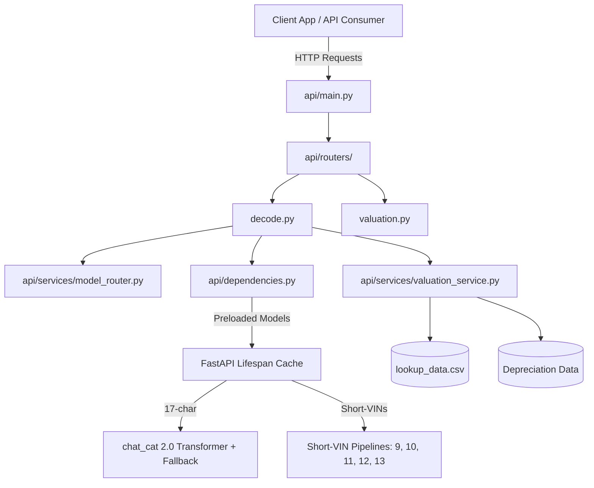

# FastAPI Architecture for Multi-Model VIN Decoder

This document outlines the proposed FastAPI architecture for serving the multi-model VIN decoding and valuation engine. 

The application currently has models trained for different VIN/Chassis lengths:
- **17 characters**: Uses a deep-learning Transformer model blended with a fallback backoff-lookup dictionary (`chat_cat(2.0)` / `chat_cat`).
- **9, 10, 11, 12, 13 characters**: Use specific short-VIN estimators/pipelines (e.g. `vin_decoder_pipeline.pkl`) located in their respective directories.

---

## Architecture Design

To ensure high performance, clean separation of concerns, and ease of maintainability, we propose a modular architecture:

### Proposed Directory Layout

We propose organizing the `api/` directory as follows:
- **[api/main.py](file:///d:/vin-sphere-python/api/main.py)**: Main entry point. Initializes `FastAPI`, registers routers, manages the `lifespan` context (preloading models to memory), and configures global middlewares (CORS) and exception handlers.
- **[api/config.py](file:///d:/vin-sphere-python/api/config.py)**: Configuration settings loader using Pydantic Settings (e.g., path configurations, model parameters, default thresholds).
- **[api/schemas.py](file:///d:/vin-sphere-python/api/schemas.py)**: Pydantic schemas validating API request bodies, path variables, and response payloads.
- **[api/dependencies.py](file:///d:/vin-sphere-python/api/dependencies.py)**: Dependency injection functions to retrieve preloaded models and cache resources from FastAPI state.
- **[api/routers/decode.py](file:///d:/vin-sphere-python/api/routers/decode.py)**: Handles decode requests (`/api/v1/decode/{vin}`).
- **[api/routers/valuation.py](file:///d:/vin-sphere-python/api/routers/valuation.py)**: Handles independent valuation lookups or depreciation requests.
- **[api/services/model_router.py](file:///d:/vin-sphere-python/api/services/model_router.py)**: Orchestrates model routing. Based on VIN length, it selects the correct preloaded model / pipeline and executes prediction without running slow dynamic imports on demand.
- **[api/services/valuation_service.py](file:///d:/vin-sphere-python/api/services/valuation_service.py)**: Serves valuation lookups using `lookup_data.csv` and depreciation rules.

---

## User Review Required

> [!IMPORTANT]
> **Model Path Setup & Preloading**
> Streamlit currently uses dynamic `sys.path` injection before importing `predict` to allow serialization/unpickling.
> In a production FastAPI environment, we recommend adding project folders containing the model modules to the Python system path at app startup, and caching the loaded models in the FastAPI `app.state` via a `lifespan` context. This avoids concurrent import race conditions.

> [!NOTE]
> **Endpoints & Query Format**
> We plan to expose:
> 1. `GET /api/v1/decode/{vin}` - Decode a given VIN and optionally return valuation if matched.
> 2. `POST /api/v1/decode` - Batch decode multiple VINs.
> 3. `GET /api/v1/health` - App healthcheck.

---

## Open Questions

> [!IMPORTANT]
> **1. GPU/CPU Execution for 17-char Transformer**
> Should the FastAPI application attempt to load the PyTorch Transformer model onto CUDA if available, or should it run strictly on CPU to reduce resource footprint on deployment?
> 
> **2. Valuation Integration**
> Should valuation/pricing lookup automatically run for every VIN decoded, or should it be an optional query parameter (e.g. `/decode/{vin}?include_valuation=true`)?

---

## Proposed Changes

### API Service Layer

#### [NEW] [main.py](file:///d:/vin-sphere-python/api/main.py)
Initializes the application, includes CORS, handles errors, and uses lifespan events to load and cache models into `app.state` on startup.

#### [NEW] [config.py](file:///d:/vin-sphere-python/api/config.py)
Stores paths for `lookup_data.csv`, `chat_cat` versions, and fallback model settings.

#### [NEW] [schemas.py](file:///d:/vin-sphere-python/api/schemas.py)
Pydantic schemas:
- `DecodeResponse`: Standardized structure containing make, model, year, trim, body type, cylinders, origin, passengers, weight, color, regional specs, attribute confidence scores, and aggregate confidence.
- `ValuationResponse`: Retail average/min/max, trade average/min/max.
- `APIResponse`: Wrapper containing decoding output and valuation details.

#### [NEW] [dependencies.py](file:///d:/vin-sphere-python/api/dependencies.py)
Provides clean access to preloaded models stored in `app.state` to endpoints.

#### [NEW] [decode.py](file:///d:/vin-sphere-python/api/routers/decode.py)
API endpoints for single and batch decoding.

#### [NEW] [model_router.py](file:///d:/vin-sphere-python/api/services/model_router.py)
Encapsulates routing rules based on VIN length (9, 10, 11, 12, 13, 17) and delegates prediction execution.

---

## Verification Plan

### Automated Tests
- Run validation scripts with mock VINs of lengths 9, 10, 11, 12, 13, and 17.
- Benchmark API performance using a simple Python script to ensure that preloaded models avoid runtime file loading overhead.

### Manual Verification
- Test using FastAPI's built-in interactive Swagger UI (`/docs`).
